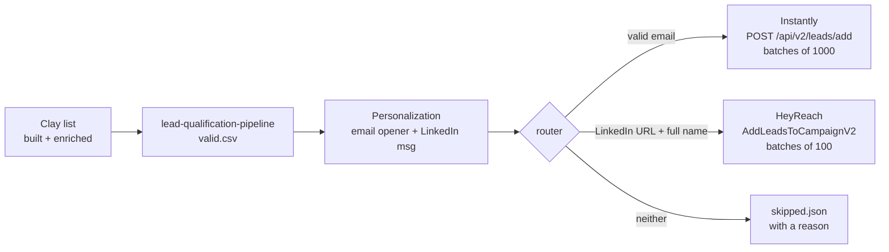

# multichannel-outbound-orchestrator

**Takes a qualified, personalized lead list and sends each lead to every channel it can actually be reached on: email through Instantly, LinkedIn through HeyReach, or both. One pass, no duplicates, nothing silently dropped.**

This is the last step of the outbound system behind 300+ booked meetings: a list built and qualified in Clay, personalized per prospect, then loaded into both channels at once so the email and the LinkedIn touch land in the same week.

▶ [Multichannel campaign walkthrough](https://www.awesomescreenshot.com/video/45656014?key=0f7971cb2ef4f4196e41993a68c8c477) · [Outbound system that booked 20+ meetings](https://www.awesomescreenshot.com/video/41694787?key=bdf5f9575f8a429d8fe9ffd1ea5b2c9e)



## What it handles

| Problem | How |
|---|---|
| Same person twice in the list | Dedup by normalized email and canonical LinkedIn URL (`linkedin.com/in/X/?utm=…` → `www.linkedin.com/in/x`) |
| Lead has only one channel | Routed to the channel it has, not dropped |
| HeyReach silently fails leads without a full name | Checked up front: no first + last name means no LinkedIn push, with the reason logged |
| Personalization lost between tools | `email_opener`, `linkedin_message`, `signal`, `offer` become Instantly `custom_variables` and HeyReach `customUserFields`, so both sequences can use `{{signal}}` |
| Rate limits | 429s retry with `Retry-After` / exponential backoff |
| Batch limits | Chunked to each API's max (1000 / 100) and totals summed |
| Pushing by accident | **Dry run by default.** It writes the exact payloads to `out/` for review, and only sends when you pass `--send` |
| Re-importing existing leads | Instantly `skip_if_in_workspace: true` |

## Run it

```bash
pip install -e ".[dev]"

python -m outbound.cli --input examples/qualified_leads.csv
# 6 leads -> email: 2, linkedin: 3 (1 on both), skipped: 2
# dry run: payloads written to out/. Re-run with --send to push.

cp .env.example .env   # fill in keys + campaign IDs, then export them
python -m outbound.cli --input valid.csv --send
python -m outbound.cli --input valid.csv --send --channels linkedin   # one channel only
```

Input columns: `first_name, last_name, title, company, domain, email, linkedin_url`, plus any of `signal, email_opener, linkedin_message, offer`. The `valid.csv` from [lead-qualification-pipeline](https://github.com/zinkwonri-kayinu/lead-qualification-pipeline) works directly once personalization columns are added.

Outputs in `out/`: `instantly_leads.json`, `heyreach_leads.json`, `skipped.json`, and after `--send`, `push_report.json` with uploaded / duplicate / blocklisted / failed counts per channel.

### Prerequisites
- **Instantly:** an API v2 key with `leads:create` scope and a campaign ID.
- **HeyReach:** a workspace API key and a campaign that is **active** with at least one LinkedIn sender assigned. The API won't add leads to a draft.

## Tests

```bash
pytest -q
# 7 passed
```

Routing, URL canonicalization, payload shapes for both APIs, batching + totals, 429 retry, and an end-to-end dry run. All HTTP is faked, so tests never touch a real account.

## Layout

```text
outbound/
  router.py    channel routing, dedup, payload shaping
  clients.py   Instantly + HeyReach clients (batching, retries)
  cli.py       dry-run / send entry point
examples/qualified_leads.csv
tests/
```

## License

MIT
